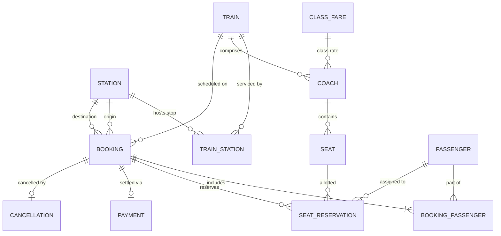

# Database Design & Relational Schema (3NF)

## 1. Entity Relationship Overview
The Railway Management System relational schema consists of 12 normalized tables adhering to Boyce-Codd / Third Normal Form (3NF).

---

## 2. Relational Schema & 3NF Justification

1. **`STATION (Station_ID, Station_Name, Station_Code, City)`**
   - **PK**: `Station_ID`, **Candidate Key**: `Station_Code`.
   - **3NF Justification**: All attributes depend strictly on the PK. No transitive dependencies.

2. **`TRAIN (Train_ID, Train_Number, Train_Name, Train_Type, Is_Active)`**
   - **PK**: `Train_ID`, **Candidate Key**: `Train_Number`.
   - **3NF Justification**: Details describe the locomotive/service identity without station route mixing.

3. **`TRAIN_STATION (Train_ID, Station_ID, Stop_No, Arrival_Time, Departure_Time, Distance_Km)`**
   - **Composite PK**: `(Train_ID, Stop_No)`, **Unique**: `(Train_ID, Station_ID)`.
   - **FKs**: `Train_ID -> TRAIN(Train_ID)`, `Station_ID -> STATION(Station_ID)`.
   - **3NF Justification**: Resolves the many-to-many relationship between Trains and Stations while storing route-specific schedule data.

4. **`COACH (Coach_ID, Train_ID, Coach_Number, Class_Type)`**
   - **PK**: `Coach_ID`, **Unique**: `(Train_ID, Coach_Number)`.
   - **3NF Justification**: Separates coach units from train headers, removing repeating coach records.

5. **`SEAT (Seat_ID, Coach_ID, Seat_Number, Seat_Type)`**
   - **PK**: `Seat_ID`, **Unique**: `(Coach_ID, Seat_Number)`.
   - **FK**: `Coach_ID -> COACH(Coach_ID)`.
   - **3NF Justification**: Eliminates seat repeating groups in coaches; seat properties depend only on seat position.

6. **`CLASS_FARE (Class_Type, Rate_Per_Km, Base_Fare)`**
   - **PK**: `Class_Type`.
   - **3NF Justification**: Extracted lookup table removing fare anomalies across individual coach and reservation records.

7. **`PASSENGER (Passenger_ID, Passenger_Name, Age, Gender)`**
   - **PK**: `Passenger_ID`.
   - **3NF Justification**: Demographic details of individual travellers are fully decoupled from booking transactions.

8. **`BOOKING (Booking_ID, PNR, Train_ID, Source_Station_ID, Destination_Station_ID, Class_Type, Journey_Date, Booked_At, Status, Total_Fare, Contact_Email, Contact_Phone)`**
   - **PK**: `Booking_ID`, **Candidate Key**: `PNR`.
   - **FKs**: `Train_ID`, `Source_Station_ID`, `Destination_Station_ID`.
   - **3NF / Denormalization Note**: `Total_Fare` is captured at transaction time as an audit ledger snapshot, protecting booking history against subsequent fare revisions.

9. **`BOOKING_PASSENGER (Booking_ID, Passenger_ID)`**
   - **Composite PK**: `(Booking_ID, Passenger_ID)`.
   - **3NF Justification**: Decomposes the many-to-many relationship between Bookings and Passengers into 1NF/2NF/3NF without repeating columns.

10. **`SEAT_RESERVATION (Reservation_ID, Booking_ID, Passenger_ID, Seat_ID, Journey_Date, Status, Active_Flag)`**
    - **PK**: `Reservation_ID`.
    - **Unique**: `(Seat_ID, Journey_Date, Active_Flag)` *(Partial Unique Key Index Trick)*.
    - **3NF Justification**: Maintains date-based seat inventory state separately from booking headers.

11. **`PAYMENT (Payment_ID, Booking_ID, Amount, Payment_Method, Payment_Status, Paid_At)`**
    - **PK**: `Payment_ID`, **FK**: `Booking_ID`.
    - **3NF Justification**: 1-to-1/1-to-many financial ledger recording simulated transaction outcomes.

12. **`CANCELLATION (Cancellation_ID, Booking_ID, Cancelled_At, Reason, Refund_Amount)`**
    - **PK**: `Cancellation_ID`, **Unique FK**: `Booking_ID`.
    - **3NF Justification**: Isolated post-booking lifecycle event keeping cancellation auditing clean and immutable.
